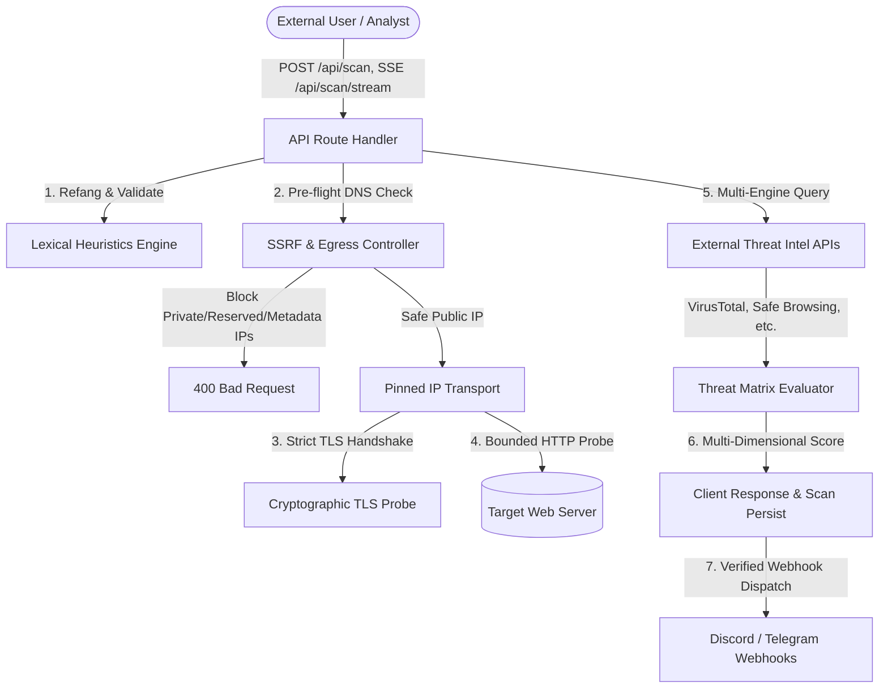
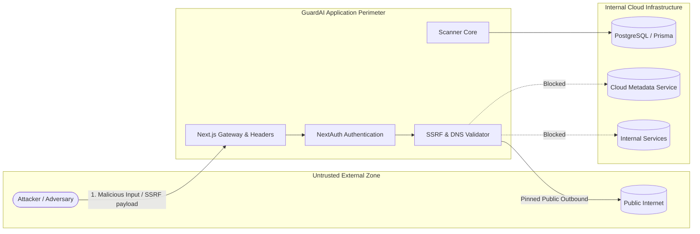

# GuardAI Threat Model

## 1. System Overview & Scope

GuardAI is an automated URL threat intelligence and cybersecurity scanner. The system receives untrusted user inputs (URLs, domains, defanged indicators of compromise), analyzes them via lexical heuristics, performs active cryptographic network and TLS probing, queries external threat intelligence vendors (VirusTotal, Google Safe Browsing, AbuseIPDB, URLhaus), and dispatches automated security alerts via webhook channels (Discord, Telegram).

---

## 2. Assets & Data Classification

| Asset | Description | Sensitivity | Security Invariants |
|-------|-------------|-------------|---------------------|
| **Internal Network Perimeter** | Cloud metadata services (`169.254.169.254`), internal cluster services, database ports (`5432`). | Critical | Zero egress traffic from untrusted scanner inputs allowed to reach internal subnets. |
| **API Secret Keys** | Provider keys (`VIRUSTOTAL_API_KEY`, `GOOGLE_SAFE_BROWSING_API_KEY`, `ABUSEIPDB_KEY`, `URLHAUS_KEY`). | High | Never exposed in browser bundles, responses, logs, or error payloads. |
| **User Webhook Credentials** | Discord webhook tokens, Telegram bot tokens, chat IDs. | High | Stored encrypted/scoped per user. Redacted/masked in all logs and client responses. |
| **Scan Telemetry & Audit Logs** | History of scanned URLs, threat scores, audit timestamps. | Medium | User-scoped. Users cannot view or mutate other tenants' scans or alerts. |
| **Scanner Verdict Authenticity** | Threat scores, TLS certificate validity, phishing probabilities. | Critical | No fake clean results. If engines are disabled/unreachable, scanner abstains with `INCONCLUSIVE`. |

---

## 3. Trust Boundaries & Attack Vectors

### Threat 1: Server-Side Request Forgery (SSRF) & DNS Rebinding
- **Vector**: Attacker submits URLs pointing to loopback (`127.0.0.1`), private networks (`10.0.0.0/8`, `192.168.0.0/16`, `172.16.0.0/12`), cloud metadata (`169.254.169.254`, `100.100.100.200`), or domains configured with short TTL DNS rebinding (`127.0.0.1.nip.io`).
- **Mitigation in GuardAI**:
  - `src/lib/ssrf.ts` parses and validates both literal IPs (including hex, octal, decimal, and IPv4-mapped IPv6) and proactive DNS resolution (`A` and `AAAA` records).
  - Pinned IP transport: Connections connect directly to the verified IP, bypassing subsequent DNS lookups during HTTP/TLS handshakes.
  - Manual redirect handling: Every redirect hop (`Location` header) is strictly re-validated against scheme, port, hostname, and resolved IP ranges (max 5 hops).

### Threat 2: Deceptive TLS Presentation (False Security Claims)
- **Vector**: Scanner connects to malicious or expired target with `rejectUnauthorized: false` and claims certificate is valid because fields exist.
- **Mitigation in GuardAI**:
  - `src/lib/tls-probe.ts` performs strict CA trust chain validation with `rejectUnauthorized: true`.
  - Exact hostname matching via SNI and SAN verification (`tls.checkServerIdentity`).
  - Strict date enforcement (`valid_from` <= now <= `valid_to`).
  - Clear status model: `VALID`, `EXPIRED`, `SELF_SIGNED`, `HOSTNAME_MISMATCH`, `UNTRUSTED_ROOT`, `REVOKED`, `UNENCRYPTED_HTTP`.
  - Unauthorized certificates are NEVER flagged as valid.

### Threat 3: Arbitrary Webhook Redirection & Abuse
- **Vector**: Attacker configures alert webhook pointing to internal server, port scan target, or competitor service to conduct DDoS or data exfiltration.
- **Mitigation in GuardAI**:
  - `src/lib/webhooks.ts` enforces strict regex patterns:
    - Discord: `^https:\/\/(?:(?:ptb|canary)\.)?discord(?:app)?\.com\/api\/webhooks\/(\d{17,20})\/([A-Za-z0-9_-]{50,80})$`
    - Telegram: `^\d{8,11}:[A-Za-z0-9_-]{35}$`
  - Rejection of query strings, userinfo, non-https schemes.
  - Per-user rate limiting (5 requests per minute) on setup and test endpoints.
  - Token masking for client displays.

### Threat 4: Threat Intelligence Misrepresentation & Silent Provider Failures
- **Vector**: When external API keys are absent, quota exhausted, or providers timeout, scanner marks target as "clean", giving users a false sense of security.
- **Mitigation in GuardAI**:
  - `src/lib/threat-intel.ts` tracks distinct provider statuses: `clean`, `malicious`, `suspicious`, `not_found`, `timeout`, `quota_exhausted`, `disabled`, `unknown`, `error`.
  - "Not found" or "disabled" is never mapped to "clean".
  - Abstention policy: If all external providers are disabled, scanner outputs `INCONCLUSIVE` verdict with explicit disclosures.

### Threat 5: Broken Object-Level Authorization (BOLA / IDOR)
- **Vector**: Authenticated user attempts to read or mutate another user's scan history or alert channels.
- **Mitigation in GuardAI**:
  - Server-side deny-by-default authorization via NextAuth sessions.
  - Database queries (`/api/audit`, `/api/alerts/config`) are strictly scoped by verified `user.id`.

---

## 4. Security Verification Gates

| Gate | Verification Method | Enforcement | Status |
|------|---------------------|-------------|--------|
| **SSRF Defense** | Unit test suite with 20+ attack vectors (`tests/ssrf.test.ts`) | CI pipeline (`npm test`) | PASS |
| **TLS Verification** | Cryptographic verification tests (`tests/tls.test.ts`) | CI pipeline (`npm test`) | PASS |
| **Webhook Destination Safety** | Regex and negative URL tests (`tests/webhooks.test.ts`) | CI pipeline (`npm test`) | PASS |
| **Threat Matrix Calibration** | Provider status & abstention tests (`tests/threat-intel.test.ts`) | CI pipeline (`npm test`) | PASS |
| **Negative Auth Isolation** | Unauthenticated 401 tests (`tests/auth-isolation.test.ts`) | CI pipeline (`npm test`) | PASS |
| **Clean Lockfile CI** | `npm ci` from committed `package-lock.json` | GitHub Actions | PASS |

