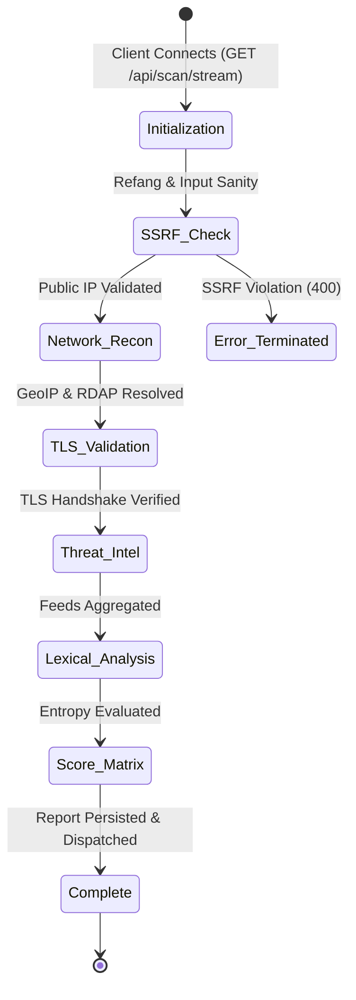

# API & Telemetry Reference

GuardAI provides both synchronous REST endpoints and asynchronous Server-Sent Events (SSE) streaming protocols for high-throughput security automation.

---

## SSE Scan Event Lifecycle



---

## Endpoint Catalog

### 1. Synchronous URL Scan
* **Endpoint:** `POST /api/scan`
* **Content-Type:** `application/json`
* **Request Body:**
  ```json
  {
    "url": "https://example.com"
  }
  ```
* **Success Response (`200 OK`):**
  ```json
  {
    "url": "https://example.com",
    "threatLevel": "safe",
    "score": 0,
    "verdict": "SAFE",
    "confidence": "HIGH",
    "abstention": false,
    "summary": "Target passed all reputation, TLS verification, and heuristic security checks.",
    "action": "Domain is safe to browse.",
    "details": {
      "virusTotal": { "status": "clean", "detections": 0, "total": 93 },
      "googleSafeBrowsing": { "status": "clean" },
      "ssl": { "valid": true, "issuer": "DigiCert Global Root G2" },
      "whois": { "domainAgeFormatted": "28.2 years", "registrar": "GoDaddy.com, LLC" },
      "securityHeaders": { "grade": "A", "missingHeaders": [] }
    }
  }
  ```

---

### 2. Real-Time Progressive Scan Stream
* **Endpoint:** `GET /api/scan/stream?url=<target>`
* **Content-Type:** `text/event-stream`
* **Protocol:** Server-Sent Events (SSE)
* **Sample Stream Chunks:**
  ```text
  data: {"step":"Initialization","status":"pending","progress":5,"log":"Running SSRF and egress safety validation..."}

  data: {"step":"Network Recon","status":"success","progress":25,"log":"GeoIP: Piscataway, US | ASN: AS20473"}

  data: {"step":"Network Recon","status":"success","progress":35,"log":"TLS Certificate cryptographically verified: VALID | Issuer: Let's Encrypt"}

  data: {"step":"Complete","status":"success","progress":100,"log":"Scan complete.","result":{...}}
  ```

---

### 3. Global Threat Telemetry Feed
* **Endpoint:** `GET /api/telemetry/stream`
* **Content-Type:** `text/event-stream`
* **Behavior:** Streams real-time global threat detections and system metrics with adaptive backoff.

---

### 4. Health & Readiness Probes
* **Liveness:** `GET /api/health` — Returns HTTP 200 with runtime diagnostics, uptime in seconds, and memory statistics.
* **Readiness:** `GET /api/ready` — Returns HTTP 200 when database connectivity is verified, or HTTP 503 during outages.

