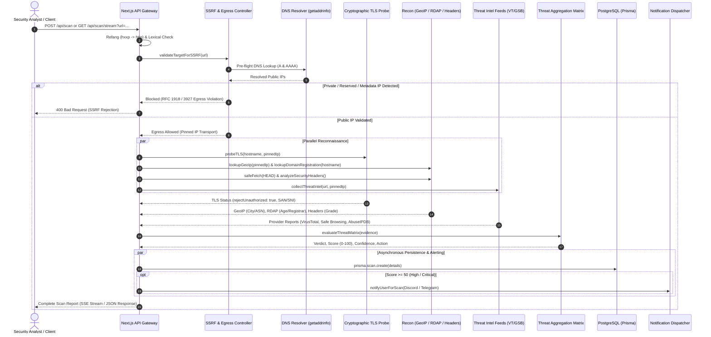
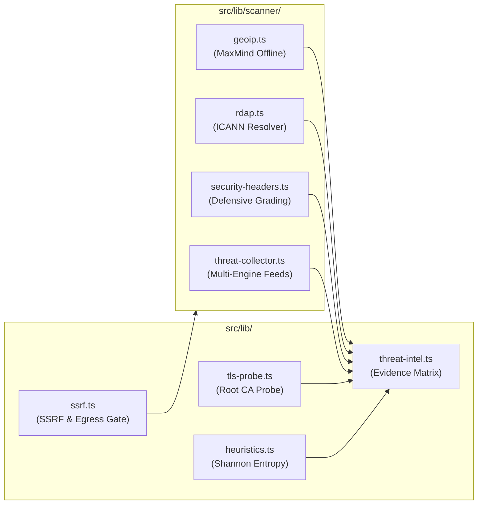

# Architecture & Pipelines

GuardAI decomposes URL threat assessment into deterministic, modular pipeline stages. By decoupling network recon, cryptographic verification, reputation correlation, and client streaming, the system prevents single-point failures and maintains sub-second responsiveness.

---

## Scanning Pipeline Sequence Diagram

---

## Pipeline Modularization

All domain logic resides in dedicated services under `src/lib/`:

### 1. SSRF & Egress Controller (`src/lib/ssrf.ts`)
* **DNS Pinning:** Resolves public IPs prior to socket initialization. Connects directly to the verified IP to defeat DNS rebinding attacks.
* **Hop-by-Hop Redirect Validation:** Enforces `redirect: "manual"` across all outgoing requests, inspecting each redirect destination against IP blocklists (up to 5 hops).

### 2. Cryptographic TLS Probe (`src/lib/tls-probe.ts`)
* **Root CA Validation:** Always sets `rejectUnauthorized: true`. Self-signed or untrusted certificates are reported as `valid: false`.
* **Identity Check:** Validates Subject Alternative Names (SAN) against the target hostname via `tls.checkServerIdentity`.

### 3. ICANN RDAP & Domain Age (`src/lib/scanner/rdap.ts`)
* **Registry Integration:** Queries authoritative RDAP registries (Verisign, PIR, ICANN bootstrap).
* **Domain Age Calculation:** Computes age in days and years. Flags newly registered domains (<30 days old) as high-risk phishing candidates.

### 4. Offline-First GeoIP (`src/lib/scanner/geoip.ts`)
* **Zero-Latency Lookup:** Uses local MaxMind database (`geoip-lite`) to resolve country, city, and coordinates in 0-2ms with zero external network dependency.
* **Enrichment Fallback:** Enriches Autonomous System Number (ASN) and ISP data via low-latency external API with fail-soft error handling.
