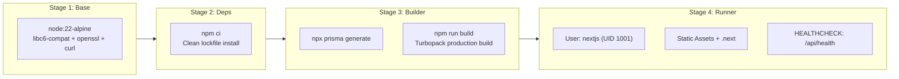
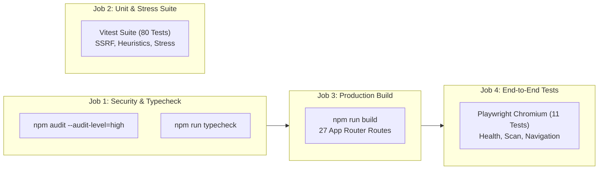

# Deployment & DevOps

GuardAI is containerized using a 4-stage multi-stage Docker build, orchestrated with Docker Compose, and verified by an automated CI/CD pipeline on every commit.

---

## Container Build Pipeline



---

## Docker Compose Quickstart

The entire platform, including database and background adapters, can be spun up with a single command:

```bash
# Clone the repository
git clone https://github.com/KatkamKoushik/guardai.git
cd guardai

# Build and start services in background
docker compose up --build -d

# Check running status and health probe
docker compose ps
```

### Container Services

| Service | Image | Internal Port | External Port | Healthcheck |
| :--- | :--- | :---: | :---: | :--- |
| **`guardai-app`** | Custom Multi-Stage | `3000` | `3000` | `curl -f http://localhost:3000/api/ready` |
| **`guardai-db`** | `postgres:16-alpine` | `5432` | `5432` | `pg_isready -U guardai_user -d guardai_db` |

---

## Continuous Integration (`.github/workflows/ci.yml`)

Every push to `master`, `main`, `feature/**`, and `docs/**` (as well as pull requests) triggers an automated multi-job pipeline:



### Pipeline Jobs Breakdown

1. **Security Audit & Typecheck:** Clean lockfile dependency check (`npm audit --audit-level=high`) and strict zero-error TypeScript validation (`tsc --noEmit`).
2. **Unit, Regression & Stress Suite:** Parallel execution of 80 tests covering SSRF loopback protections, Shannon entropy calculation, cryptographic TLS verification, constant-time compare, and concurrency bursts (500 security header checks, 100 concurrent SSRF queries).
3. **Optimized Production Build:** Full Turbopack compilation verifying zero build errors, asset compilation, and route generation across all 27 routes.
4. **Playwright End-to-End Suite:** Spin-up of production server on port 3000, Chromium browser execution, API health and readiness validation, SSRF boundary blocking, and client page navigation.
