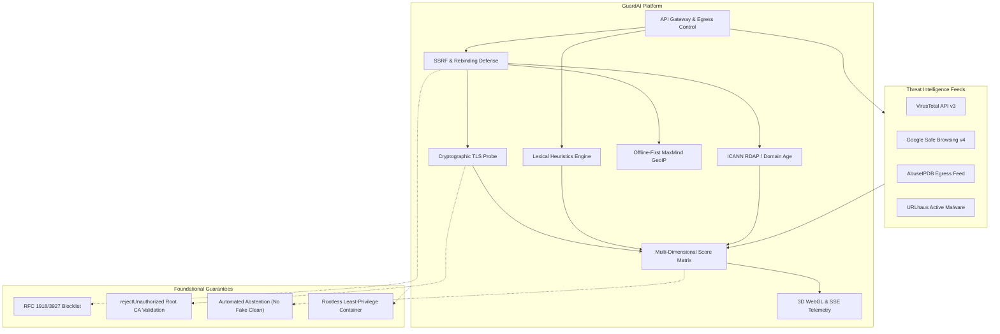

# GuardAI Engineering & Security Knowledge Base

Welcome to the official technical documentation for **GuardAI** — an automated, enterprise-grade cybersecurity platform combining real-time threat intelligence, cryptographic network verification, SSRF defense, and 3D WebGL global threat telemetry.

---

## System Capabilities Map

---

## Knowledge Base Sections

Explore the technical chapters below for in-depth engineering breakdowns:

1. **[Architecture & Pipelines](Architecture-and-Pipelines)**
   * End-to-end scanning lifecycle sequence diagram.
   * Modular domain design in `src/lib/scanner/`.
   * Pinned IP transport and hop-by-hop redirect verification.

2. **[Threat Model & Security](Threat-Model-and-Security)**
   * Assets, trust boundaries, and network threat modeling.
   * Defense-in-depth against SSRF, DNS rebinding, and denial-of-service.
   * Audit trail logging and secret masking.

3. **[API & Telemetry Reference](API-and-Telemetry-Reference)**
   * Full OpenAPI 3.1 endpoint schemas for `/api/scan`, `/api/scan/stream`, and `/api/telemetry/stream`.
   * SSE event protocol specifications and sample payload structures.
   * Liveness (`/api/health`) and Readiness (`/api/ready`) probes.

4. **[Threat Evaluation Matrix](Threat-Evaluation-Matrix)**
   * Mathematical scoring formula (0–100 calibrated risk).
   * Confidence level calculation (`HIGH`, `MEDIUM`, `LOW`).
   * Explicit provider statuses and automated abstention semantics (`INCONCLUSIVE`).

5. **[Deployment & DevOps](Deployment-and-DevOps)**
   * 4-Stage rootless Docker containerization (`node:22-alpine`).
   * Automated container healthchecks and PostgreSQL 16 Alpine orchestration.
   * Continuous Integration 4-stage pipeline with static analysis, 80 Vitest unit/stress tests, and 11 Playwright E2E tests.

---

## Operational Status & Health Metrics

| Metric | Target | Verified Status |
| :--- | :---: | :---: |
| **Vulnerabilities** | `0` | Pass: 0 vulnerabilities (`npm audit`) |
| **Static Typing** | `100% Strict` | Pass: `tsc --noEmit` Exit 0 |
| **Automated Tests** | `> 50 tests` | Pass: 91 tests passed (80 Unit/Stress + 11 Playwright E2E) |
| **Container User** | `Non-Root` | Pass: `nextjs:nodejs` (UID 1001) |
| **Production Build** | `Zero-Error` | Pass: 27 routes compiled (`npm run build`) |
