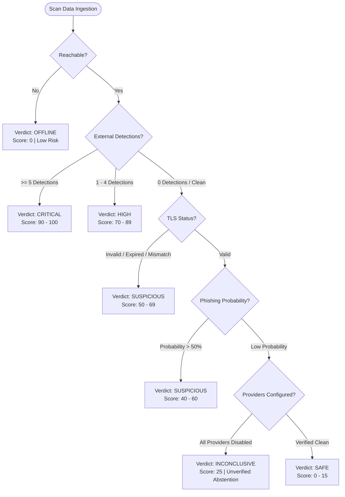

# Threat Evaluation Matrix & Scoring Semantics

GuardAI employs a multi-dimensional risk aggregation algorithm that synthesizes external threat intelligence, cryptographic certificate authenticity, lexical entropy, and network reachability into a single calibrated risk score between 0 and 100.

---

## Verdict Decision Tree

---

## Score Calibration & Threat Levels

| Score Range | Threat Level | Verdict | Operational Action |
| :---: | :---: | :---: | :--- |
| **85 – 100** | `critical` | `CRITICAL` | Block IOC at network perimeter; isolate endpoints. |
| **65 – 84** | `high` | `HIGH` | Block access; trigger automated security alerts. |
| **35 – 64** | `suspicious` | `SUSPICIOUS` | Route traffic through secure web gateway; inspect headers. |
| **20 – 34** | `suspicious` | `INCONCLUSIVE` | External intelligence unverified; manual triage recommended. |
| **0 – 19** | `safe` | `SAFE` | Domain verified safe for access. |

---

## Automated Abstention Policy

GuardAI strictly prohibits assuming a clean state in the absence of evidence:

1. **Provider State Differentiation:**
   - `disabled`: The API key is absent from server configuration.
   - `timeout`: The external provider did not respond within 6000ms.
   - `quota_exhausted`: The API rate limit has been reached.
   - `error`: The external provider returned an HTTP 5xx error.
2. **Abstention Invariant:**
   - If **all** external providers are `disabled` or in error, and lexical heuristics are inconclusive, GuardAI marks the result as `INCONCLUSIVE` (`abstention: true`) and generates explicit limitation notes rather than asserting that the site is safe.

