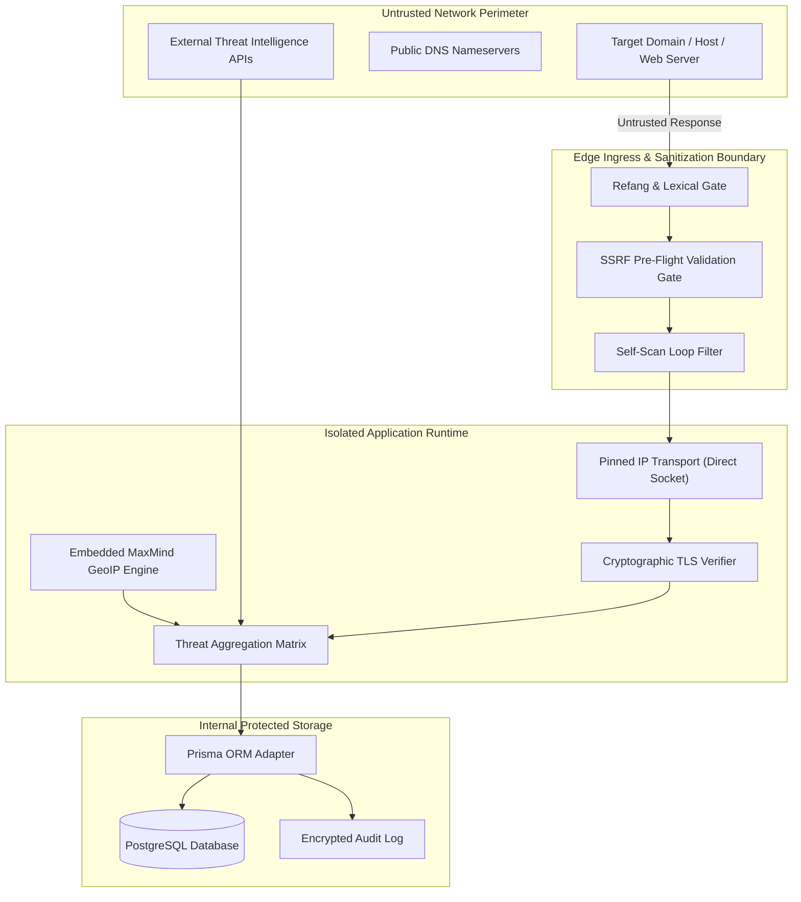

# Threat Model & Security Posture

GuardAI implements an explicit, evidence-backed security posture designed to defend both the platform infrastructure and end-user analysts against malicious adversaries, evasive payloads, and egress exploitation.

---

## Trust Boundaries & Zone Architecture

---

## Threat Matrix & Adversarial Scenarios

### 1. Server-Side Request Forgery (SSRF) & Cloud Metadata Extraction
* **Attack Vector:** An attacker supplies target inputs pointing to internal private addresses (`http://169.254.169.254/latest/meta-data/` or `http://10.0.0.1/admin`).
* **Mitigation:**
  - Strict pre-flight DNS A and AAAA record resolution.
  - Deny-by-default filtering against all RFC 1918, RFC 3927, RFC 6598, loopback (`127.0.0.0/8`), and link-local address spaces.
  - Hex (`0x7f000001`), octal (`0177.0.0.1`), decimal (`2130706433`), and IPv4-mapped IPv6 normalization.

### 2. Time-of-Check to Time-of-Use (TOCTOU) DNS Rebinding
* **Attack Vector:** A domain resolves to a benign public IP during initial inspection, but resolves to `127.0.0.1` upon subsequent HTTP fetch.
* **Mitigation:**
  - Pinned IP transport: The initial validated IP address is pinned to the outbound HTTP/HTTPS socket transport. The destination cannot switch between DNS queries.

### 3. Untrusted / Forged SSL Certificates
* **Attack Vector:** A phishing site uses an invalid or self-signed certificate, or an expired wildcard certificate.
* **Mitigation:**
  - Native Node.js TLS verification runs with `rejectUnauthorized: true`.
  - SNI and SAN hostname matching via `tls.checkServerIdentity`.
  - Unauthenticated certificates are strictly flagged as `valid: false`.

### 4. False-Clean Deception & Silent Provider Failures
* **Attack Vector:** Threat intelligence services experience API rate limits, timeouts, or quota exhaustion, leading systems to report the target as "Safe".
* **Mitigation:**
  - Multi-dimensional status model distinguishing `clean`, `malicious`, `disabled`, `timeout`, and `error`.
  - Automated abstention policy: When external intelligence is unverified, GuardAI returns `INCONCLUSIVE` rather than asserting a false negative clean verdict.

